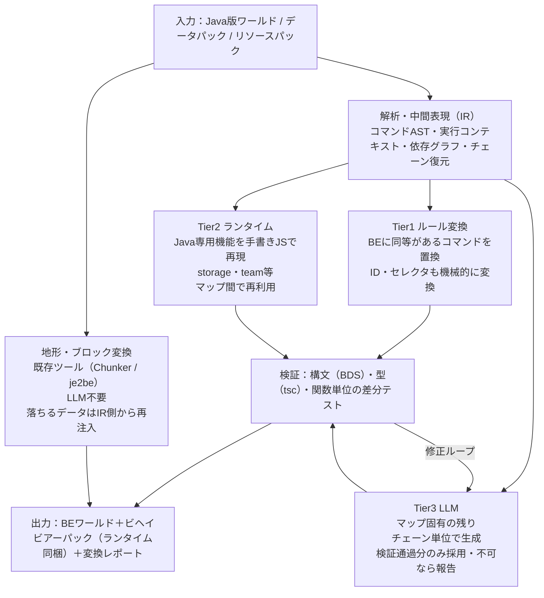

# JE→BE 配布ワールド変換コンバータ 検討メモ

2026-11-10 時点 / 原本: https://claude.ai/artifact/YMoJVawWXCp3jJfaV9fogL

## 概要と結論

LLMは「コマンドの翻訳者」ではなく「決定的な変換とランタイムで扱えない残り（ロングテール）の担当」に置くのがよい。

- **目的**：Java版（JE）の配布ワールド（アドベンチャー・脱出マップ等）を統合版（BE）で遊べるようにする。
- **前提**：地形・ブロックの変換は既存ツール（Chunker / je2be）で実用段階。課題はコマンドブロック・データパック・Java版専用エンティティなど「ゲームロジック」の移植。
- **方針**：コマンドの大半はパターンが決まっているため、ルールベース変換と再利用可能なJSランタイム（polyfill）で吸収し、マップ固有の部分だけLLMと人が補う。
- **成功指標**：コマンド変換率ではなく「人手なしで動くギミックの割合」と「壊れる箇所を事前にレポートで当てた割合」。

## これまでの検討経緯

[ChatGPTとの議論](https://chatgpt.com/share/6af31fb4-6f10-83ec-984d-c30f9809f3a9)では、コマンドブロックとレッドストーンを残すハイブリッド方式で合意した。主な結論は次のとおり。

| 論点 | 結論 |
| --- | --- |
| 地形変換 | 既存の変換器に任せる。ただしエンティティやスコアなどが欠落し得るので比較検証が必要 |
| チェーンの復元 | コマンドブロックの座標・向き・条件付きフラグから機械的にグラフ復元できる。LLM不要 |
| 非互換コマンド | `/scriptevent` でScript APIに逃がす。レッドストーンによる起動は元のまま残す |
| 最大の落とし穴 | `/scriptevent` は送信できれば常に成功し、条件付きチェーンに判定結果が伝わらない。実行タイミングもずれ得る |
| 変換単位 | 依存関係（同じスコアを読み書きする等）があるコマンド群はまとめてScript APIへ移す |
| 動作確認 | 初期は人力。ただし人が確認しやすい変換レポートは最初から出す |
| 将来の用途 | クラフターズコロニーでの投稿者向け移植支援ツール |

## 前提となる意思決定事項

推奨初期スコープは「作者支援寄り・Java版1.20.5以降のデータパック中心マップ・BE安定版API固定・ローカルCLI」。以下の5点で要件が大きく変わる。

| 論点 | 選択肢 | 影響 | 推奨 |
| --- | --- | --- | --- |
| 利用者 | ①プレイヤーが個人用に変換 ②マップ作者が自作品を移植 | ①は全自動で「遊べる」ことが最優先、レポートは読まれない。②は半自動でよく、レポートと手直しのしやすさが重要。権利面も②が素直 | ②（未決） |
| 対象Java版バージョン帯 | 1.12以前 / 1.13〜1.20.4 / 1.20.5以降 | 1.12以前はコマンド構文が別物（旧`execute`、数値ID）。1.20.5でNBTがデータコンポーネントに変わりアイテム記法が変化。文法ごとにコストがかかる | 1.20.5以降から |
| 出力先BEバージョン | 固定 / 追従 | Script APIはメジャーバージョンで破壊的変更がある | 1バージョンに固定、安定版APIのみ |
| 対象プラットフォーム | Windows / スマホ / コンソール / Realms | コンソールは.mcworldを自由に取り込めない。スマホは性能制約が強い | Windowsとスマホ |
| 形態 | ローカルCLI / Webサービス | サービス化すると信頼できない入力、計算資源、作者の許諾が必要 | ローカルCLI |

1.20.5以降を推すのは、最近のデータパックが構造化されていて解析しやすく、文法も1系統で済むため。ただし配布マップの実際のバージョン分布はPhase 0で確認してから確定する。

## アーキテクチャ案

地形は既存ツールに任せ、ロジックは3層で変換して、LLMは最後の層だけを担う。

要はTier2のランタイム。`data` / `storage` / `execute store` / `if data` / NBTセレクタ / `team` / `bossbar` / `trigger` / `schedule` / マクロをJava版の意味どおりに動くJSライブラリとして一度作れば、普通のソフトウェアとしてテストできる。マップごとにLLMを使うのはTier3の固有ギミックだけになり、検証に落ちたものはエラーを渡して再生成する。

## 既存議論への追加論点

ChatGPTとの議論で抜けていた8点。特に「カスタムコマンド」は、最大の落とし穴（成否が伝わらない問題）を回避できる可能性がある。

### 1. Script APIのカスタムコマンドで成否を返す（要検証）

`customCommandRegistry.registerCommand` で独自コマンド（例：`jc:ifdata`）を登録でき、ハンドラは Success / Failure を返せる。`/scriptevent` と違い、Script側の判定結果をそのまま成否にできる可能性がある。

- 制約：ハンドラは制限付き実行モード。読み取りは即時にできるが、書き換えは `system.run` で後回しになりタイミング問題が戻る
- 効く範囲：Java専用機能の多くは条件判定（`if data`、NBTセレクタ、`predicate`）なので、読み取りだけで広くカバーできる
- 検証項目：条件付きチェーンが失敗で止まるか、コンパレーター出力、制限モードで可能な操作

### 2. 「クリックで実行」系はUIの再設計が必要

| Java版の仕組み | 用途の例 | BE側の代替案 |
| --- | --- | --- |
| 看板の `click_event: run_command` | 「看板を右クリックでスタート」 | `playerInteractWithBlock` イベント＋座標→処理の対応表 |
| 本の `click_event` | 設定メニュー、選択肢 | `@minecraft/server-ui` のフォーム |
| `tellraw` のクリック／ホバー | チャット上の選択肢 | フォーム（BEのrawtextにはクリック／ホバーがない） |
| `trigger` objective | プレイヤーからの入力 | フォーム、またはカスタムコマンド |

本のページ構造からフォームを組み立てるなど、LLMの得意分野。

### 3. イベント検知の仕組みは対応表で置き換える

Javaのマップはスコアボードの統計値や進捗でイベントを検知するのが定番。BEにはどちらもないが、Script APIのイベントにほぼ直接対応する。LLM不要でカバー率への効果が大きい。

| Java版 | BE Script API |
| --- | --- |
| `minecraft.used:carrot_on_a_stick` などの右クリック検知 | `itemUse` |
| `minecraft.custom:minecraft.deaths` / `killed:*` | `entityDie` |
| `minecraft.custom:minecraft.leave_game` | `playerLeave` |
| 進捗トリガー（`player_interacted_with_entity`、`consume_item`、`location` 等） | 対応するafterEvents |
| `sneak_time` など継続系の統計 | 毎tickのポーリング |

### 4. Java版専用エンティティにはpolyfillエンティティが必要

`marker`、`text_display` / `item_display` / `block_display`、`interaction`（クリック判定）はBEに無い。変換器が同梱するパックに代替のカスタムエンティティ（不可視マーカー、ネームタグでのテキスト表示、当たり判定用エンティティ等）を用意し、元ワールドから再注入する。

### 5. コマンド文字列内のIDも変換が必要

ワールド変換器はコマンドの中のIDまでは変換しない。

- ブロックステート：`oak_stairs[facing=north,half=top]` → `minecraft:cardinal_direction`、`upside_down_bit`
- サウンド：`block.note_block.pling` → `note.pling`
- パーティクル（体系が別物）、エンチャント名、エフェクト、エンティティID

対応表は自作せず、Geyserのmappingsや Chunker / je2be の内部テーブルを流用・参照する（ライセンス要確認）。

### 6. マクロがあるので実行時インタプリタが要る

Java版1.20.2以降の関数マクロ（`$` 行）は実行時にコマンド文字列を組み立てるため、事前変換では原理的に扱えない。ランタイム側にJavaコマンドのパーサと実行器を持たせ、変換器とパーサを共有する。文法はJava版サーバーのデータジェネレーター（`--reports`）が出す `commands.json` から機械的に作れる。

### 7. ワールドへの再注入は .mcstructure 経由が楽

BEのLevelDBを直接編集する代わりに、変換器が落とすものを差分として扱う。

- コマンドブロック・エンティティ → `.mcstructure`（リトルエンディアンNBT）として生成
- スコア・storageの初期値 → JSONとしてパックに同梱
- 初回起動時の初期化スクリプトが `/structure load`、スコア設定、動的プロパティ書き込みを行う

どの変換器が何を落とすか（スコアボード、エンティティの残り方）は最初に実測する。

### 8. コマンド以外の挙動差

- アドベンチャーモードの `CanPlaceOn` / `CanDestroy` → BEの `can_place_on` / `can_destroy`（変換可能）
- 鍵アイテムの判定（`custom_data` 一致）→ BEに自由なNBTがない。lore、名前、動的プロパティ（スタック不可アイテムのみ）で代替
- アスレチックの距離感：移動物理や当たり判定の差で跳べない箇所が出る。自動検知は困難なのでレポートで警告
- 地図アイテム（マップアート）、モブAI、レッドストーン（準接続性など）
- リソースパック：コアシェーダー（BEに対応なし）、カスタムフォントによるGUI、`item_model` / CustomModelData。参考実装はGeyser向けの java2bedrock.sh

## 機能要件（たたき台）

LLMが関わるのはEのみで、それ以外はすべて決定的に実装する。

| 区分 | 要件 |
| --- | --- |
| A. 入力解析 | level.datの `DataVersion` と pack.mcmetaの `pack_format` からバージョン判定。全チャンクのコマンドブロック（ブロックステート＋NBT）、看板、本、エンティティを抽出。データパックの関数・タグ（`load` / `tick`）・進捗・predicate・ルートテーブル・レシピを読む。`scoreboard.dat`、`command_storage_*.dat`、forceload範囲、ストラクチャーテンプレートも対象 |
| B. 解析・中間表現 | バージョン別文法でコマンドをAST化。チェーンのグラフ復元。スコア・タグ・storage・座標・エンティティの読み書き依存解析。Tier1〜3のどれで変換するか自動判定（不明なら安全側） |
| C. 変換 | ID対応表（ブロック・アイテム・サウンド・パーティクル・エンティティ）。セレクタ変換（`distance`→`r/rm`、`limit/sort`→`c`、`x_rotation`→`rx/rxm`。`nbt` / `predicate` / `team` はランタイムへ）。テキストコンポーネント→rawtext。`tick` → BEの `tick.json`、`load` → ワールド読み込み時のスクリプト |
| D. ランタイム（Tier2） | storage、NBT風データ、`execute store`、`team`、`bossbar`、`schedule`、`trigger`、進捗の代替、マクロ実行。状態は動的プロパティで永続化（サイズ制限に注意）。polyfillエンティティ群 |
| E. LLM層（Tier3） | チェーン1本・関数群1つ単位で投入し、IRと依存情報を添える。出力は構造化し、検証を通ったものだけ採用。「実現できない」報告も正当な出力 |
| F. 出力 | ワールド、ビヘイビアー／リソースパック、manifest、権限・gamerule設定。変換レポート（元の座標・関数 ↔ 生成物の対応表、Tier分類、警告） |

## 検証戦略

最終確認は人力だが、その前の3層は安く自動化できる。

1. **構文チェック**：変換済みmcfunctionをBDS（Bedrock Dedicated Server、Linux版あり）に読み込ませ、コンテンツログからエラーを拾う。生成JSは `@minecraft/server` の型定義に対して `tsc` で型チェック。どちらもLLM修正ループの入力にできる
2. **関数単位の差分テスト**：Java版サーバーとBDSの両方で「初期状態をセット → 関数やチェーンを実行 → スコア・タグ・指定範囲のブロックをダンプ」して比較。マップ全体ではなくギミック単位で意味の同一性を確かめる
3. **シナリオテスト（後回し）**：BEのGameTestの `SimulatedPlayer` で移動・アイテム使用・ブロック操作を自動化。ギミックごとのクリア手順を書けば回帰テストになる
4. **人力プレイテスト**：変換レポートの「要確認箇所」を優先して見る

指標は2つ。「人手なしで動くギミックの割合」と、「実際に壊れた箇所のうちレポートが事前に警告していた割合（見逃し率の裏返し）」。

## LLM利用の設計方針

LLMは変換時にだけ使い、出力は必ず検証器を通す。ゲーム実行時にはLLMを呼ばない。

- **APIの幻覚対策**：Script APIは変化が速く、学習データには古いAPIが混ざる。ターゲットバージョンの `.d.ts` とコマンドリファレンスを毎回コンテキストに入れ、型チェックで弾く
- **再現性**：入力とプロンプトのハッシュで結果をキャッシュする。再変換のたびに結果が変わると修正が積み上がらない
- **コスト**：大きいデータパックは関数が数千ファイルになる。Tier1/2で何割吸収できるかがそのままコストを決める
- **使う価値が高い場所**：慣用句の認識（再帰関数によるレイキャスト → ネイティブのレイキャストAPI、エンティティを使ったタイマー → `system.runTimeout` など）、クリック系UIの再設計、ギミックの説明文生成、エラーからの修正
- **使わない場所**：ID対応、セレクタ変換、チェーン復元、manifest・権限設定など決定的に書けるものすべて
- **データの扱い**：作者のコンテンツを外部APIに送るので、サービス化するならその旨を明示する

## 非機能要件とリスク

技術面で最も危ういのは性能（特にスマホ）、運用面では配布マップの改変・再配布の権利。

| 項目 | リスク | 対策 |
| --- | --- | --- |
| 性能 | Script APIのウォッチドッグ。毎tick数百個のリピートコマンドブロック相当をJSで回すとスマホで厳しい。`functionCommandLimit` などBE側の上限もある | まず互換性優先、実機計測後にイベント駆動化 |
| API安定性 | Beta APIは実験的機能の有効化が必要で仕様も変わる | 安定版APIのみ、ターゲットバージョン固定 |
| チャンク読み込み | `forceload` → `tickingarea` は個数上限あり。初期化スクリプトも未読み込みチャンクには触れない | 常時読み込み領域を特定し、上限内に集約 |
| 権利 | 配布マップの多くは改変・再配布を禁止している | 個人利用に限定し出力の再配布禁止を明示。公開は作者の許諾前提 |
| サービス化時の安全性 | ZIP爆弾、パストラバーサル、重い変換ジョブ | 展開時の検査、資源制限、生成コードをサーバーで実行しない |

## 進め方

最初にやるべきは、LLMを使わない「コーパス調査」。どの機能から手を付けるかを、感覚ではなくデータで決められる。

1. **Phase 0：コーパス調査**：実在の配布マップ20〜50本を対象に、使用機能を数える解析器を作る。出すもの：コマンド別出現頻度、Java専用機能の使用率、セレクタ引数、エンティティ種類、リソースパック機能、対象バージョン分布。入力解析（機能要件A）の大半がここでできる
2. **Phase 1：技術PoC**：下のチェックリストを実機で確かめる
3. **Phase 2：小規模マップを1本通す**：Tier1と最低限のTier2で動かし、残りをLLMと人力で埋める。工数と詰まった箇所を記録する
4. **Phase 3：拡充**：Tier2ランタイムの拡充、LLM層の組み込み、差分テストの自動化

### Phase 1 PoCチェックリスト

- [ ] `scriptevent` の実行順序（後続チェーンより先にScriptが状態を変えられるか）
- [ ] カスタムコマンドのFailureで条件付きチェーンが止まるか、コンパレーター出力はどうなるか
- [ ] カスタムコマンドの制限モードで可能な操作（スコア読み取り、エンティティ検索、インベントリ参照）
- [ ] 実行コンテキスト（`sourceBlock`、ディメンション、相対座標）を復元できるか
- [ ] Chunker / je2beで変換後、コマンドブロック・エンティティ・スコアボードがどこまで残るか
- [ ] `.mcstructure` 生成＋初回起動スクリプトでの再注入が成立するか
- [ ] チャンクの読み込み・ワールド再起動後も状態が正しく復元されるか

## 未決事項と次のアクション

次の一手はPhase 0の解析器（Javaワールドとデータパックを読み、使用機能の統計を出すCLI）の設計と試作。

- [ ] 主な利用者を決める（プレイヤー個人 / マップ作者）
- [ ] 対象Java版バージョン帯を決める（Phase 0の結果を見て確定）
- [ ] 出力先BEバージョンと `@minecraft/server` のバージョンを決める
- [ ] 地形変換エンジンを選ぶ（Chunker / je2be、ライセンスと欠落データを比較）
- [ ] Geyser mappings等の対応表のライセンス確認
- [ ] Phase 0用の配布マップコーパスを集める（利用規約の範囲内で）
- [ ] Phase 0解析器の設計・試作
