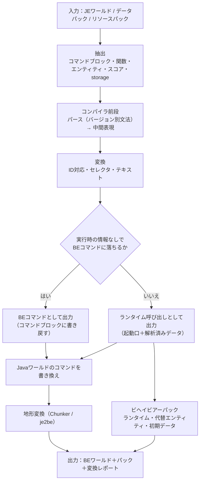

# JE→BE 配布ワールド変換コンバータ 設計方針

2026-11-15 時点。`design-notes.md`（2026-11-10の検討メモ）を、サンプルマップ19本の調査結果で見直したもの。食い違う箇所はこの文書を優先する。

「未確認」と書いた項目は、実機で確かめるまで仮定として扱う。M0 の PoC（7章）で確かめた結果は `docs/findings.md` にある。残る未確認の項目は、それぞれの Issue で追う。

## 1. 目的とスコープ

Java版（JE）の配布ワールドを、統合版（BE）で遊べる `.mcworld` に変換する。地形とブロックは既存の変換器（Chunker / je2be）に任せ、このプロジェクトはゲームロジック（コマンドブロック、データパック、Java専用エンティティ）の移植を担う。

| 項目 | 方針 |
| --- | --- |
| 利用者 | マップ作者による自作品の移植（2026-11-15確定）。BE の Script API やコマンドを書ける前提にせず、変換できなかった理由と Java 側で修正できる情報をレポートする（#117） |
| 最終目標 | The Sky Blessing（Project TSB）を BE で遊べるようにする（2026-11-15 所有者が設定、#50）。データパックは CC0-1.0（一部ライブラリは MIT / Apache-2.0）、リソースパックは Apache-2.0。建築データは改変・再配布でき、再配布時は公式サイト（project-tsb.org）の URL を記載する（公式サイトのライセンスの項） |
| 対象JEバージョン | 1.20.4〜26.x の指定安定版。1.20.4 は対象に決定済みで、対応実装はこれから（#146・#164）。過去の版も完成後に追加できる構成とする |
| 出力先BEバージョン | 最新版に追従する（2026-11-15確定）。Script APIはベータ版も使ってよい。互換性のためにベータ版が必要な場面を想定する。使うAPIのバージョンは `package.json` で固定し、BE更新時に上げる |
| 形態 | ローカルCLI |
| 開発の進め方 | AIエージェントがほぼ自律的に開発・検証できる構成にする |

## 2. 調査結果（設計の根拠）

対象はクラフターズコロニーの週間人気上位から集めた19本（`sample-map/`）。集計は `scripts/` のスクリプトで再現できる。Java専用機能の判定は正規表現による粗いものである。

### 2.1 マップの区分

| 区分 | 本数 | マップ |
| --- | --- | --- |
| データパックなし・単発コマブロのみ | 1 | 3000mアスレチック |
| データパックなし・チェーンあり | 3 | 深海からの脱出、帝國立海洋生態研究所、Aurora |
| データパックあり・単発コマブロのみ | 6 | 1000mwr、ONLY-UP、Rhythm-Parkour、この家には玄関がない、人狼クエスト、勇者と魔王 |
| データパックあり・チェーンあり | 5 | 27_island、Lock_in_pumpkin、back-to-back、エンドレス・コア、見習いの魔法使い |
| データパックだけ（コマブロなし） | 4 | distortion_hotel、古き信仰者の遺跡、競MOB、ClockmakerManor |

- データパックにロジックを持つマップは15本、コマンドブロックを持つマップも15本ある。どちらか一方だけの対応では大半のマップを扱えない。
- ClockmakerManorはワールドを含まず、データパック単体で配布されている。

### 2.2 コマンドブロック

コマンドの型ごとの頻度（作者が書いた部分を伏せた集計）は `docs/corpus-patterns.md` にある（#45）。

- チェーンは合計1,975本。長さは1個が1,403本、2〜3個が429本、4〜10個が119本、11個以上が24本。
- 2個以上のチェーンが多いのは深海（310本、最長118個）とエンドレス・コア（173本）の2本。ほかは多くても数十本で、大半が短い。
- コマンド3,550個の粗い分類は、BEにも同名コマンドがあるもの2,033個、関数呼び出し573個、Java専用機能を含むもの935個、空9個。
- Java専用機能の内訳は、NBT付きの `summon`（564個）と表示用エンティティ（444個）が中心で、設置用の一度きりのコマンドが多い。
- 条件付きブロックは281個（5本のマップ、うちback-to-backが155個）。
- レッドストーンで動作を切り替えるリピートブロックが多い（27_islandに80個、深海に69個、エンドレス・コアに64個）。
- クリックイベント付きの `tellraw` が深海に87個ある。

### 2.3 データパック

- マクロを使うマップは、ワールド付きの14本中9本。
- 15本すべてが `marker` / `interaction` / 表示用エンティティ（`text_display`、`item_display`、`block_display`）のどれかを使う。`marker` だけのマップは1本で、残り14本は表示用か `interaction` を使う。
- `data` コマンドの対象は、多くのマップでstorageよりエンティティが多い。
- 規模の差が大きい（326行〜約7万行）。人狼クエストの約7万行のうち約6.1万行は、Animated Java（モデルアニメーション生成ツール）の出力である。競MOBも `item_display` への操作が2,400行ある。

### 2.4 バージョン

| バージョン | 本数 |
| --- | --- |
| 1.20.1 / 1.20.4 | 各1 |
| 1.20.6 | 1 |
| 1.21 | 2 |
| 1.21.4 | 2 |
| 1.21.11 | 2 |
| 26.2 | 2（ほかにデータパック単体1本が26.2〜26.3対応） |
| 26.3 | 7 |

- 1.20.5以降で19本中17本をカバーする。最多は26.x系である。
- 1.21.5でテキストの書き方がJSON形式からSNBT形式に変わった。対象範囲内に両方の書き方が存在する（JSON形式の時期が5本、SNBT形式の時期が12本）。
- 26.x系ではチャンクの保存形式が変わっている（パレットのキーが `id` / `properties`、保存先が `dimensions/minecraft/overworld/region`）。

## 3. 設計原則

1. **コンパイラとランタイムは1つ**。コマンドブロックもデータパックも同じパーサ、同じ中間表現、同じランタイムに通す。経路を分けるのは出力の段階だけにする。
2. **主経路はScript API側のランタイム**。BEコマンドへの書き換えは、それだけで完結する場合の出力形式と位置づける。
3. **中核はTypeScriptで書き、変換時（Node）とゲーム内で同じコードを使う**。マクロは変換時に型紙を作り、ゲーム内では穴のある引数を型ごとに処理する（5.2）。
4. **Minecraftに依存しない部分を最大化する**。ランタイムの意味論はホストAPIから切り離し、Node上でテストできるようにする。
5. **Java側の正解は実サーバーの実行結果で決める**。ソースやWikiは理由を調べるときに使う。
6. **厳密に一致させる範囲を限定する**。スコア演算、storage、NBTパス、マクロ、関数の制御フローは一致させる。物理、モブの挙動、演出のタイミングは近似とし、レポートで警告する。
7. **変換できないものは黙って落とさず、レポートに出す**。
8. **LLMは決定的に書けない部分だけに使う**。変換時はクリックUIの再設計や未対応箇所の説明など。ゲーム実行時には呼ばない。

## 4. 全体構成

ランタイム中核は `packages/core`、Script API ホストは別パッケージ、出力パックの組み立ては converter に置く。詳細と未決定事項は [ランタイム構成](runtime-architecture.md) を参照（#95）。

## 5. コンポーネント

### 5.1 抽出

- JEワールドから、コマンドブロック（種類、向き、条件付き、常時実行、コマンド本文）、看板、本、エンティティ、スコアボード、storage、forceload範囲を取り出す。
- データパックから、関数、タグ（`load` / `tick`）、進捗、`predicate`、ルートテーブルなどを読む。ZIP形式のパックと、ワールドなしのデータパック単体配布も扱う。
- 26.x系の保存形式に対応する。JE側の形式は変わり続けるため、最新版への追従を前提にする。
- TypeScript で実装した（`packages/converter`、#12）。配布マップ19本で Python の試作（`scripts/extract_command_blocks.py`）と件数が一致し、試作が種類を判定できなかった29個も判定できる。26.x では既定値の状態が省かれるため、データ生成の `blocks.json` で補う。

### 5.2 コンパイラ前段（パーサと中間表現）

- 対象は1.20.4〜26.xの指定安定版の文法（1.20.4 は実装待ち）。テキストはJSON形式とSNBT形式の両方を読む。バージョンは `DataVersion` と `pack_format` で判定する。
- 中間表現は、コマンドの構文木に実行コンテキスト（`execute` の as / at / positioned / rotated / anchored / in）の情報を付けたもの。
- ゲーム内でも動かすので、依存の重いライブラリは使わない。既存のパーサ（Spyglassなど）は文法の参照元として使う。
- 実装（#13、`packages/core/src/command/`）：
  - 文法の木は、Java 版サーバーのデータ生成（`--reports`）が出す `commands.json` をそのまま使う（Mojang のデータのためリポジトリには入れず、変換時は `servers/` から読む。ゲーム内の生成パックには同梱しない。所有者判断は #107）。Brigadier と同じ規則でたどり、引数の中身の書き方（セレクタ、座標、ブロック、アイテム、SNBT、NBT パス、テキストなど）は引数の型ごとに実装する
  - 中間表現は `CommandIR`：`execute` のサブコマンドを書かれた順に並べた `context`（入れ子の `run execute` も平らにする）と、最後に実行する `command`。各引数は型付きの値（セレクタの引数、座標の種類、NBT のタグなど）を持つ
  - パーサが確かめるのは文法だけで、ID の実在や値の形は確かめない（#59）
  - 変換時の追加検証（#59）は、定義を含むパックを固定 Java に読み込ませ、ID・値の拒否と参照不足を警告レポートにする。`registries.json` の一覧照合を文法の合否には加えない。パックを読み込めなければ未判定として区別する（`docs/command-validation.md`）。実行時の引数処理はサーバー非依存とする
  - 正解は、コマンドを関数にして Java 版サーバーに読ませた判定（`checkJavaSyntax`）。配布マップの重複を除いた約10万件で、文法の判定は Java と一致した（`docs/findings.md`）
  - 版別の文法（#58）は `setup:grammars` で代表的なリリースから別枠で生成する。DataVersion、なければ pack_format で選び、未生成・不明・曖昧な版は最新版へ置き換えず未判定とする。1.21.4 / 1.21.5 の実サーバーで JSON / SNBT の境目（安定版の DataVersion 4325、形式71）を確認。生成・選択と対象リリースは `docs/command-versions.md`

### 5.2.1 版追加の構成（#164）

- 入力の DataVersion、なければ曖昧さを検査した pack_format で元版を確定し、その版の `commands.json`、引数の文法（アイテム・NBT・テキストなど）、レジストリ・既定値と ID 対応を選ぶ。不明・欠落・曖昧な版は近い版に代用せず診断する。版の判定情報はパックや関数の出所に結び付ける。
- 元版の構文を解析してから、型付き IR と必要な保存データを版境界ごとの独立した正規化部品に順番に通し、現行の正規表現にする。例えば 1.20.4→1.20.5 を一部品とし、さらに古い版はその手前に部品を足す。対象範囲内の版差も同じ形で扱う。例えば 1.20.5〜26.2 の引数名・型の差は #199 で対応し、未対応の差は診断する。各部品は入力・出力の版と対応範囲を明示し、変換不能・意味を保てない値は診断して未対応にする。NBT パスなど動的な操作も意味を保てない場合は黙って置換しない。
- 正規化後の IR を共通の BE 変換・ランタイムで扱い、Java の版ごとの分岐を実行中のコマンド処理に増やさない。IR のスキーマ版や永続化形式の版は入力 JE 版とは別に管理する。BE 対応表は正規化済み ID と出力 BE 版に対して選ぶ。旧版固有の ID・既定値を現行の表へ直接渡さない。
- マクロ行は変換時に元版の文法で固定部分の IR と型付きの穴に分ける（#316）。実行時は呼び出しの複合タグから値を取り出し、型紙に記録した元版・テキスト形式で穴のある引数だけを読み、境界処理を通して実行する。コマンドの形が変わり得る行、引数境界をまたぐ穴、実行時の ID 対応表が必要な型は変換時に理由付きで報告する。キーの欠落や型紙の範囲を越える値は関数の実行前に失敗する。
- 新しい旧版を足す際は、公式配布元・ハッシュ・関数ディレクトリを `tools/java-grammars.json` に固定し、`npm run setup:grammars -- <版>` で生成する。`tools/servers.json` は現行の検証サーバー用として維持し、旧版追加だけでは切り替えない。版情報と差分を調査し、版選択・構文・境界正規化・ID と未対応のテストを追加する。合成入力で元版の Java サーバーを正解にした実機比較と、隣接版・既存版・複数境界の連結の回帰テストを置く。マクロは元版のテキスト形式と動的値も検証し、非公開マップの本文は使わない。

### 機能の族と共有判定（#110、#228）

族ごとに `packages/core/src/features/<族>/` を置き、共通 parser の `CommandIR` を受ける `capability.ts` の判定と、`rewrite.ts` の BE 生成、`runtime.ts` の実行口を分ける。判定契約は構文不正・ネイティブ可・要ランタイム・未対応を区別し、理由、順序付き警告、必要な文脈を返す。構文不正は parser の結果から渡し、未実装をランタイム対応とみなさない。execute の合成や横断引数は共通層に残す。

新しい族はこのディレクトリに判定と各経路を置き、共通のコマンド登録から呼ぶ。族の判定テストは近傍に置き、既存の parser・rewrite 統合テストと対応するシナリオ・実サーバーテストでも結果と警告順を確認する。score・storage の実行口は各族の `registration.ts` に登録し、共通の `runtime/command.ts` は登録済みの判定と実行口をたどる。execute の合成は共通層に残す。互換性台帳は同じ登録の判定を使い、Java の正解とランタイムを比較するシナリオで実行した入力に一致する文法形だけに `runtime` とシナリオ・テストの根拠を付ける。形単位の判定は他の値や実行文脈の成功を保証しない。

### 5.3 変換（中間表現 → BE向けの表現）

- ID対応（ブロックとブロックステート、アイテム、エンティティ、サウンド、パーティクル、エフェクト、エンチャント）。対応表の入手元は Geyser mappings を採用する（#14、2026-11-15 所有者承認）。ID・状態の対応と変換に必要な情報を使い、MIT の著作権表示・許諾文を変換器と表を含む生成パックに同梱する。出典は `THIRD_PARTY_NOTICES.md`、種類ごとの不足と実機検証案は `docs/id-mapping-sources.md` を参照。ゲームから抽出した既定コンポーネント・形状等のデータ一式の同梱は採用範囲に含めない。
- セレクタ変換（`distance` → `r` / `rm`、`limit` / `sort` → `c` など）。`nbt=`、`predicate`、`advancements=` はランタイムで評価する。
- テキストコンポーネント → rawtext。クリックとホバーはBEにないため、UI再設計（5.9）へ回す。`nbt` 成分は値の読み出しが要るため、ランタイムに回す理由として報告する（実行は #345 の後）。`keybind`・`object` は unsupported。成分の頻度と BDS での確認範囲は [text-components.md](text-components.md)（#347）。
- マクロの実行時処理は 5.2 の型紙に従う。動的な ID に対する対応表の適用は #316 の範囲外。

- 座標：整数座標の中心寄せ、セレクタの `x=,y=,z=`、`~` の扱いは BE と Java で一致するため、書き換えない（#10）。ただしブロック座標に小数を直接書いたコマンドは、Java では構文エラーで動かないが BE では動く。そのまま移さず、レポートに出す
- ディメンションIDの対応（`the_nether` → `nether`）。`execute in` での座標の 1/8 換算は両エディションで同じ（#8）
- 実装（#62、`packages/core/src/command/rewrite.ts`、テキストは `packages/core/src/features/text/`（#347））：
  - パースした節の位置を使い、元の文字列のうち変える部分（セレクタ、ブロック、テキスト、ディメンション、時間、偽プレイヤーの名前）だけを差し替える。結果は `rewritten` / `unchanged` / `unsupported`（BE のコマンド1個にできない。理由つき）/ `invalid`（Java の文法で読めない）
  - 書き換えるコマンドの形は `packages/core/src/command/rewrite.ts` の `COMMANDS` と `EXECUTE_STEPS` に列挙する。対応できない形は `unsupported` にする。
  - `playsound` と `particle` の ID は Geyser の固定表を使う（#90）。音のカテゴリは省略して警告し、位置を省いた音には実行位置 `~ ~ ~` を明示する。粒子のオプション、拡散・方向、速度、複数個の指定、`force`、明示した表示対象はレポートに未対応として記録する。未登録 ID も未対応として記録する。
  - ブロックの置き方（`setblock` など）は、省いた状態を Java の既定値（`blocks.json`）で補ってから表で引く。ブロックの条件（`execute if block`、`fill ... replace`）は、BE の条件が書いた状態だけを比べること（実測）を使い、同じ Java のブロックの別の状態まで一致してしまう条件（`[waterlogged=true]` など）は `unsupported` にする
  - ワールド変換では、Chunker 1.21.0 の JAR、出力形式 `BEDROCK_R26_60`、Java 26.3 の状態順と固定 Geyser 表が #111 の計測条件に一致するとき、`beetroots` と `brown_mushroom_block` の主層の差を補正する（#323）。配置と条件は同じ表を使う。条件が区別すべき Java 状態に同じ BE 主層が割り当てられた場合は、`if` と `unless` の両方で診断する。水没を指定した配置には副層の水が入らない旨を警告する。採用範囲と再計測条件は [実測記録](findings.md#地形とコマンドのブロック状態を揃える323) を参照。同じ計測条件では、`water` と `lava` の条件だけ流水 `flowing_*` を静止の ID に置き換え、`liquid_depth` で照合する。配置は Geyser 表の `flowing_*` のまま使う（#340、[実測記録](findings.md#水溶岩の流体状態340)）。
  - 変換（`convertWorld`）では、Chunker に渡す前の Java ワールドのコピーでコマンドブロックの `Command` を書き換える（5.10）。コマンド単位の書き換え結果とチェーン単位の振り分けを `ConvertReport.commands` に出す。

### 5.4 出力先の決定

**コマンド単位**

- 実行時の情報なしでBEコマンド1個に落ちる → BEコマンドとして出力する。
- それ以外 → ランタイム呼び出しとして出力する。

**チェーン単位**

| 条件 | 扱い |
| --- | --- |
| 全ブロックがBEコマンドに落ち、ランタイム側との共有依存がない | そのまま残す。コマンド文字列だけを書き換える。成否の伝搬やコンパレーター出力は元のまま動く |
| 1個でも落ちない、または共有依存によりランタイムに寄せる | 先頭ブロックを起動口に差し替え、チェーン全体をランタイムで実行する。2個目以降は無効化する |

- #321 では `commands.chains` に振り分けと理由を Java のディメンション・座標付きで出す。合流・ループ・先頭のない配置と、処理できない命令は未対応として記録し、既存のコマンド単位の書き換えを適用する。標準のコマンドブロックは向きの先を一つだけ指すため、複数の起点が後続を共有する配置は合流として検出する。
- ランタイムに回すチェーンは、各ブロックの位置・向き・条件と変換済み IR をパックに含める。成否を必要としない委譲は書き込み可能な段階で実行する。条件付きブロックや `execute store` が同期評価できない委譲の成否を必要とする場合は #93 の判断待ちを報告する。後続を無効化したブロックのコンパレーター出力やチェーン間の依存は #236・#103 に残る。

- データパックの関数は、すべてランタイムで実行する。共有状態の読み書きに依存する処理もランタイムに寄せ、保留値を含めて同じ順序で見えるようにする（#93）。ネイティブとの競合や依存を検出できない場合の完全性は未検証。
- 常時実行のリピートチェーンをワールドから抜き出してtick処理に変える方式（仮想化）は、初期設計に含めない。レッドストーンで切り替えるリピートが多く、ブロックを残すほうが起動条件とチャンク読み込みをそのまま再現できるためである。性能が問題になったときの最適化として残す。

### 5.5 起動口

M0 の結論（#11、2026-11-15 確定）。根拠は 7章のチェックリストと `docs/findings.md`。

- **起動口はカスタムコマンドにする**（#317 の関数起動例は `je2be:run <関数ID> ~ ~ ~ ^ ^ ^1 <ディメンション> [@s]`）。実行者を省略してもディメンションが明示できるよう、ディメンションを先に置く。理由：
  - ハンドラがチェーンの途中で同期的に動き、返した `Failure` が条件付きチェーンと比較器に伝わる（#3 の `poc/launcher`）
  - `scriptevent` は常に成功扱いで、ハンドラはチェーンの最後まで進んだ後に動くため、成否も順序も再現できない。起動口には使わない
- **実行コンテキストは引数で渡す**。`execute` を挟むと発生元（`sourceBlock`）が失われるため。位置は `~ ~ ~`、向きは `^ ^ ^1` との差、実行者は `@s`。ディメンションは発生元からわからないので、変換時に `execute in` から静的に決まればその値を、`at <エンティティ>` で決まればそのエンティティを渡す（#8）。整数座標の中心寄せは両エディションで同じなので、座標は書き換えない（#10）
- **方式 A（#93 承認）**：ハンドラ内で同期的に解釈し、禁止されるワールドへの書き込みを保留する。自前で確定できた成否を返し、未確定の成否を成功と仮定しない。詳細と承認範囲は `docs/proposals/runtime-execution-model.md`。
  - #317 は変換済みの関数を起動する。ハンドラが同期実行できない委譲に達したときは診断を出し、コールバックからは結果を返さない。
  - #236（#93 の判断2、案1）：変換器が `deferred` を付けたチェーンは、ハンドラでは実行せずキューに積み、そのtickの毎tick処理で保留スコアの投影の直後に起動順で丸ごと実行する。委譲は `runCommand` の `successCount` で成否を得て、後ろの条件付きブロックに渡す（`deferred-chain.servers.test.ts`）。ハンドラは先頭の成否を知らないので `Failure` を返し、先頭の比較器は点灯しない。移したチェーンの外の比較器が先頭の成否を使う場合の扱いは PM が決める（#236 のコメント）
  - #321 のチェーンも同じ起動口を使う。変換器が付けた ID を `je2be:run "chain@0" ~ ~ ~ ^ ^ ^1 minecraft:overworld` のように引用符で囲む。コールバックから返すのは先頭コマンドの成否。
- **ハンドラ内でできること**：ブロック・エンティティの読み取りと、動的プロパティの読み書きは同期的にできる。スコアの書き込み、ブロックの設置、召喚、`runCommand` は禁止（#3）
  - したがって、ランタイムの状態（storage、スケジュール、仮想NBT）は動的プロパティに置いて同期的に更新する
  - ワールドへの書き込み（スコアを含む）はランタイムのキューに積み、ランタイムの毎tickの処理の先頭（`tick` 関数より前）で反映する（5.6、#19）。反映は同じtick内、そのtickのコマンドブロックがすべて動いた後になる（#3、#5）
- **新たに設計が必要な点**（M2 で実装）：
  - 自分の書き込みを読む：キューに積んで未反映の書き込みは、ランタイム内の読み取りに重ねて見せる（オーバーレイ）。そうしないと、同じチェーンの後半が前半で書いたスコアを読めない
  - BEコマンドの成否：ハンドラ内では `runCommand` が使えないため、BEコマンドに任せた処理の成否は同期的にわからない。ランタイムが自前で評価できるもの（スコア、storage、条件）は評価し、できないものを成功とみなさない。後段が成否を使い同期評価できない委譲の扱いは未決（#93、#168）
- 静的に検出してレポートに出すもの：
  - ランタイムに回したチェーンの成否を、コンパレーターや後続の条件付きブロックが読んでいる箇所。
  - 同tick内で、ランタイムに回したチェーンとBEコマンドのまま残したチェーンが同じ状態を読み書きする箇所。
  - 同tick内で、チャンクをまたぐ独立したリピートブロック同士が同じ状態を読み書きする箇所。チャンク間の実行順は両エディションとも定まらないため（#18）
  - コマンドブロック自身を書き換えるコマンド（`data modify block` など）。

### 5.6 ランタイム

- 通常関数は変換時に版付き IR にし、解析済みの構文木を解釈実行する方式から始める。マクロは #155 の結果を待つ。JSコードへのコンパイルは、性能が問題になった箇所にだけ後から入れる。
- 2層に分ける。
  - **中核（Minecraft非依存）**：実行コンテキスト、関数呼び出しと `return`、スコア演算、storage、NBTパス、マクロ展開、`schedule`、`execute store`、条件評価。
  - **ホスト層**：Script APIへの薄い接続。候補エンティティの取得、ブロック操作、ネイティブ委譲、永続化、時刻。セレクタの意味と同期成否は中核で扱う。
- 後段が成否を使い同期評価できない委譲の扱いは未決（#93、#168）。実行フレームとキューに命令数・深さ・分岐数の予算を設け、超過やエラーを診断する。
- `tick` タグの関数はScriptのタイマーから毎tick呼ぶ。`load` はワールド読み込み時に呼ぶ。
- ホストは確定世代を復元してから `load` を呼び、毎 tick は保留スコアの投影、移したチェーン（#236）、期限に達した `schedule`、`tick` タグ、状態の確定の順に実行する（#235）。コマンドブロック起点の一般の書き込みキューは #19 で扱う。
- **tick の原則（#93 承認）**：起動直後のずれは許容する。稼働中の tick のずれは致命的とみなし、どうしてもずれる場合は関係する処理を丸ごと1 tick 後ろにずらし、同じ tick 内の前後関係が崩れる部分的なずれを避ける。反映・`schedule`・`tick` 関数の順序はこの原則を基準に定める。
- （2026-11-15 承認、根拠は #3、実装は #19）コマンドブロックから起動した処理の書き込みは `system.run` に任せず、ランタイムが持つキューに積む。ランタイムの毎tickの処理では、`tick` 関数より先にこのキューを反映する。`schedule` を含む全体の相対順序と稼働中の同 tick の関係は未検証であり、上記の原則に照らして検証する。`system.run` のままだと `runInterval` の後に動くため、Javaでは読めるはずの値（直前のコマンドブロックが書いた値）を `tick` 関数が読めない
- **スコアと storage の状態（#94 承認、未実装）**：ランタイムが担当する依存単位のスコアはランタイムを正本とし、ハンドラ内では保留中の値を読む。BE スコアボードはサイドバーなどの表示とネイティブ境界への投影とする。初期値を取り込んだ後は無条件の双方向同期をせず、名前・UUID の対応と削除も投影する。共有状態はランタイムに寄せ、ネイティブとの競合が残るか検出できない場合は警告し対象外とする。外部ネイティブとの順序や依存検出の完全性は未検証。
- Java のスコア演算と保持者は BE にそのまま委ねない。負数の除算・剰余、加算のオーバーフロー、ゼロ除算の成否、UUID 保持者の実体との対応には差がある（#140、`docs/findings.md`）。保持者の長さの上限は未測定。
- storage は `packages/core/src/nbt` を基に、数値型・配列・リスト・複合と long の精度を保持する型タグ付きの版付き形式で表す。動的プロパティへ UTF-8 で 1 件 32,767 バイト以下に分割し、名前空間・キー・世代・分割数を索引に持つ。変更した storage 単位だけを書き、保存を tick 境界にまとめる。容量不足や書き込み失敗は明示し、切り詰めない。分割、負荷、復元は未検証（#140）。
- スコアと storage は同じ世代で保存し、全片の書き込み後に確定マーカーを更新する。起動時は最後の完全な確定世代を復元して BE の投影を再構築し、旧世代は確定後に回収する。実測（#200、`docs/findings.md`）では、強制終了後も一貫した確定世代から復元できたが、残る世代は BDS が動的プロパティを保存した時点に依存し、起動時や前回の正常停止時まで戻りうる。`save hold` でも保存時点は保証されなかった。確定していない片は無視され、確定世代の片の欠けは停止として明示する。索引は動的プロパティ 1 件に収まる範囲に限られ、600 個の objective で超えた（#391）。強制終了で失う範囲を縮める手段は未決（#392）。確定していない片の回収は #393。
- スケジュールと仮想NBTも動的プロパティに保存する。仮想NBTは M3 の対象。
- 後の段階で足すもの：`team`、`bossbar`、`trigger`、進捗、`predicate`、ルートテーブル、`item`、`attribute`、`damage`。

### 5.7 仮想NBT層

`data get entity`、`nbt=` セレクタ、NBT付きの `summon`、`execute store ... entity` は、すべてエンティティやブロックのNBTを読み書きする。次の2つを合成して、JavaのNBTとして見せる層を独立した部品として作る。

- **Script APIから取れる値**：位置、向き、タグ、体力、所持品、名前など。
- **ランタイムが保持する値**：代替エンティティの表示設定、BEに対応する項目がないNBT。

対応するNBTパスは、コーパスでの使用頻度順に決める。頻度の集計は [corpus-survey.md の「NBTパス」](corpus-survey.md#nbtパス)にある。`{…}` のルート照合と `transformation`・`start_interpolation` の 5 万行台は 1 作品の表示用エンティティのアニメーションと推定し（件数が台帳の `data modify entity … merge value` と同規模であることが前提、#345）、5.8 の専用経路で扱う。残りは数百行の規模で、位置・向き・速度・UUID の読み取りが上位にある。

最初の形（#345、読み取りだけ）：

- **置き場所**：機能の族として `packages/core/src/features/entity_nbt/` に置く（`virtual.ts` が値の組み立て、`capability.ts` が対応判定、`registration.ts` が実行）。中核の `runtimeFamilies` に登録し、ほかの族と同じく変換器の振り分けとランタイムの実行で同じ判定を使う。
- **ホストのインターフェース**：`Pos` と `Rotation` は候補エンティティ（`RuntimeEntity` の `position`・`rotation`）から作る。`ExecutionHost` に任意の読み取り `entityMotion(id)`（ブロック/tick の `[x, y, z]`）と `entityUuid(id)`（Java の符号付き int 4 つ）を足した。ホストが値を返さなければ理由付きの `unsupported` にする。BE ホストの `entityMotion` は `Entity.getVelocity()` を返す（Java の Motion と単位・値が一致するかは未確認、BDS での確認はホスト層 #102 の後）。
- **ランタイムが持つ値との合わせ方**：今は Script API で取れる値だけを使う。BE の `Entity.id` は Java の UUID と別物のため、`UUID` はランタイムが保持する値（変換時の UUID をエンティティの動的プロパティに持つなど）が要る。保持の形式は書き込みと合わせて後続の子で決め、それまで BE ホストは `entityUuid` を持たない。
- **対応範囲**：`data get entity <対象> <パス> [倍率]`、その `execute store result|success … run`、`data modify storage … set|merge|insert|prepend|append from entity <対象> <パス>` の読み取り元。パスは `Pos`・`Rotation`・`Motion`・`UUID` と、それぞれに添字を1つ付けたもの（負の添字、int 配列の添字を含む）。対象は1体に限り、0 体は失敗とする。値は Java の型に合わせる（`Rotation` は float に丸めるため、`12.7f` の 10 倍は 126 になる）。正解データは `scenarios/datapack/entity-nbt-read`。
- **対応しないもの**：ほかのパス、パスなし（NBT 全体）、`nbt=` を含むセレクタ、書き込み（`data modify|merge|remove entity`）、`string entity`、storage 以外への `from entity` は、変換器の判定とランタイムの実行の両方で `unsupported entity NBT: <理由>` とし、BE への委譲に回さない。`execute if data entity`、`nbt=`、NBT 付きの `summon`、`execute store … entity` は後続の子（#182）。

### 5.8 代替エンティティ

15本すべてが使うため、最優先の部品とする。パックに同梱し、ワールド内の既存エンティティは初期化時に置き換える。

| 種類 | 難度 | 代替 |
| --- | --- | --- |
| `marker` | 低 | 不可視のカスタムエンティティ |
| `interaction` | 中 | 当たり判定だけのエンティティ＋クリックイベント |
| `text_display` | 中〜高 | カスタムエンティティでの文字表示。背景、向き、拡大縮小の再現度が課題 |
| `item_display` / `block_display` | 高 | モデルを持つカスタムエンティティ。リソースパックのモデル変換が必要 |

Animated Javaなどの機械生成アニメーションは、1行ずつ解釈実行すると性能も再現度も見込めない。生成物のパターンを認識し、BEのエンティティアニメーションへ直接変換する専用経路を別に設ける。初期は未対応としてレポートに出す。

### 5.9 クリックUIとイベント検知

- `tellraw` や本のクリックイベント、看板のクリック、`trigger` は、BEのフォーム（`@minecraft/server-ui`）やブロック操作イベントに置き換える。変換時にLLMで再設計する候補である。
- スコアボードの統計値や進捗によるイベント検知は、Script APIのイベントへの対応表で置き換える（アイテム使用、死亡、退出など）。

### 5.10 ワールドへの書き戻し

M0 の結論（#11、2026-11-15 確定）：

- **変換前のJavaワールドでコマンド文字列を書き換え、その後で Chunker に通す**。Chunker 1.21.0 はコマンドブロックの種類・向き・条件付き・常時実行・名前とコマンド文字列をそのまま運び、変換後の BE で動く（#6）。BE の LevelDB を直接編集しなくて済む
- コマンドブロックを新しく置く必要があるときは `.mcstructure` を生成して読み込む。自前で生成したコマンドブロックが BE で動くことは確認済み（#3、#9）
- 代替エンティティの配置はパックに同梱し、初回起動時に初期化する。Chunker はエンティティを運ばないため、BE に同じものがある通常のエンティティ（防具立て、モブなど）も同じ経路で再配置する（#6）。
- 実装（#61、#89、`packages/converter/src/convert.ts`）。Java の保存データからエンティティとスコアを読み、初期化パック（`behavior_packs/je2be_init`）に入れる。Chunker に渡すコピーから保存エンティティを外し、Chunker と初期化パックの両方から配置されるのを防ぐ。
- 初回の `world.afterEvents.worldLoad` で目的変数を作り、対象チャンクを一時的に読み込んでエンティティを配置する。Java の UUID は対応する BE エンティティへのスコア設定に使う。ワールドの動的プロパティ `je2be:initialized` が初期化済みであることを記録する。
- 省いた種類・属性と、復元対象に結び付かなかった UUID スコアを変換レポートに残す。初回の復元で起きたエラーはコンテンツログに残す。storage の復元は未実装。
- **ランタイムの初期状態（#94 承認、未実装）**：変換器は Java の `command_storage_*.dat` を型付きで読み、版付き初期データを分割してパックへ埋め込む。ランタイムはスコア初期化と UUID 対応の順序を合わせて初期値を取り込み、検証後にスコアと storage の初回世代を確定する。完了マーカーの後に実行を許し、中断した未確定世代は捨てて再試行する。既存の確定状態を初期値で上書きしない。型・空値・大容量・失敗後の再試行と起動順は後続実装で検証する。

### 5.11 変換レポート

- 変換できなかった箇所とその理由を中心に、元の次元・座標や関数のパスで示す。
- 未対応の機能、順序ずれの恐れや見た目が変わる箇所も伝える。
- 作者が読む前提で Java 側の用語を使い、推奨手順を示す場合は Java 側で変換可能にする修正を示す。生成物を作者が修正する流れは前提にしない。
- 手修正を再変換後も保つ上書きの仕組みは、今の設計の対象にしない（#117）。
- 形式（#351、PM 決定）：作者が読む Markdown（`<出力>.report.md`）を、機械向けの JSON（`<出力>.report.json`）と並べて出す。HTML やゲーム内の本は後続。
  - 概要に入力の DataVersion、変換器の版（git のコミット）、検査した範囲と検査していない範囲、要対応・注意・情報の件数を書く。範囲はその変換で行った処理から作り、固定文にしない
  - 詳細は「どこが（Java の次元・座標、またはパック名と `path:行`）／何が（元のコマンド・エンティティ）／なぜ（日本語）／対処（Java 側で直す内容。決まっていなければ「対処は未定」）／コード」の表にする
  - JSON の `reason`・`issues` は全部、安定した警告コード（`CMD_NOT_NATIVE`、`DP_MACRO_SHAPE`、`ENTITY_JAVA_ONLY` など）と日本語の文に対応づけ、JSON の `warnings` にも同じ一覧を載せる。対応は `packages/converter/src/convert-report.ts` の規則表で、分類できない理由は `UNCLASSIFIED` になり試験で落とす。英語の内部の理由は Markdown に出さない
  - 警告がないことを動作の保証とは書かない
  - #321・#103 の振り分けの警告は、それぞれが JSON に足し、この規則表にコードを足す

## 6. 検証

| 層 | 確認すること | 手段 |
| --- | --- | --- |
| 1. Nodeのみ | パーサ、変換、ランタイム中核 | Javaサーバーで記録した正解データとの突き合わせ |
| 2. ヘッドレスサーバー | BEコマンドの実挙動、tick内の順序、ホスト層 | BDSとJavaサーバーを同じCLIで操作するブリッジ |
| 3. 擬似プレイヤー | クリックやアイテム使用で起動するギミック | BEは `SimulatedPlayer`、JEはボット |
| 4. 実クライアント | 見た目、代替エンティティ、UI | サーバー側で視点を固定し、JEとBEのスクリーンショットを比較 |

- ブリッジは、コマンド実行、状態ダンプ（スコア、タグ、ブロック、エンティティ）、ログ取得、リロードを提供する。BDS側は `@minecraft/server-net` を使うテスト用パックで実現する。
- 正解データは「初期状態、実行するコマンド、結果の状態」の組として保存する（`scenarios/`、`docs/scenarios.md`、#38）。
- 検証の対象は、自作の検証用マップにする（2026-11-15 決定、#44）。生成スクリプトから Java 版サーバーで組み立て、ワールドのファイルはコミットしない。権利の問題がなく、再現でき、CI で流せる。詰め込む機能の型は、配布マップの統計（頻度）で決める（#45）。コマンドの文面はコピーしない。
- 配布マップは集計（静的な対応率、#47）にだけ使う。
- 通しプレイは人が行う。実際の配布マップでの最終確認は、作者の許可を得た作品だけで行い、作者の Java 版でのクリア手順を回帰テストに使う（#48、M2 以降）。
- 指標は「人手なしで動くギミックの割合」と「実際に壊れた箇所のうち、レポートが事前に警告していた割合」。

## 7. 進め方

2026-11-28、所有者が段階を組み直した（#423、#424）。それまでの M0〜M5 は技術の層ごとの段階で、どれを終えても「このマップが遊べる」と言えなかった。今は、遊べるマップの規模で段階を切る。

| 段階 | 到達点 | 範囲 |
| --- | --- | --- |
| 段階1 | 1〜3時間で遊べる、約1,000コマンド規模のマップを、人手なしで BE で遊べる（所有者は約1カ月で見たい） | よく使うコマンドとデータパックの処理（関数・スコア・storage・マクロ・`schedule`・進捗・predicate の主な条件・エンティティと仮想NBT・表示エンティティ・アイテムの基本・クリックUI）。完全な網羅は求めない。音と粒子は含めない |
| 段階2 | 静的処理を広げ、変換できるマップを増やす | 命令・エンティティ・データ駆動の機能の網羅、音と粒子、見た目の比較、作者向けの配布、募集した作品での確認 |
| 段階3 | The Sky Blessing を BE で遊べる | 半年規模の先の目標。段階1・2の間は TSB の取得・集計をしない |

- **段階1の締め**（#423）：配布マップの型の分布に合わせた**代表マップ**（#402）を自作し、変換して BDS で正解データと一致させ（#420）、所有者が実クライアントで通しプレイする（#421）。配布マップの文面は写さない
- **募集の関門**（#422）：題材の実マップの募集は、代表マップが成立し、手元の中規模の配布マップで段階1に受け持ちのない未対応が一定以下になってから、所有者が判断する
- **範囲の決め方**：段階1に入れるのは、代表マップの必須ギミックか募集の関門を妨げるものだけ。ほかは段階2へ回す。Issue は段階の開始時に締めから逆算して一度に切る
- 進行上の必須性は #69 のギミック評価で確認し、未検証や既知の欠落を明示する。族ごとの網羅（[族別の計画](proposals/compatibility-milestones.md)）は段階2で進める

旧段階（履歴）：M0 検証基盤と PoC、M1 コマンドブロックだけの検証用マップは完了。M2（ランタイム中核と起動口）の残りは段階1に、M3〜M5 は段階1に要る部分を除いて段階2に移した。

### PoCチェックリスト（M0）

- [x] 地形変換器（Chunker / je2be）は、コマンドブロックのコマンド文字列、向き、条件付き、常時実行をそのまま運ぶか
  - Chunker 1.21.0（MIT）で Java 26.3 → BE 1.26.60 形式を確認。種類・向き（上向き含む）・条件付き・常時実行・レッドストーン必要・名前付きは運ばれ、BE でそのまま動く。コマンド文字列は変換されない。現行構文の `execute` も動く（BE 側の `Version` を書かない実装だが問題は出なかった）
  - je2be は GPL-3.0 で、2025-11 以降更新がなく、Linux 用の CLI も配布されていないため比較対象から外した
- [x] 同じく、エンティティとスコアボードはどこまで残るか
  - Chunker 1.21.0 は Java 26.3 のワールドからエンティティを1体も運ばない（防具立て、豚、marker、表示用エンティティ、interaction。Java→Java 変換でも同じ）。スコアボードと storage も運ばない
  - したがって、エンティティ・スコア・storage は、変換前の Java ワールドから自前で取り出し（`packages/core/src/java/world.ts`）、BE の初期化時に再配置する（5.10）
  - 根拠：`poc/terrain-converter/`（`results.chunker.json`）
- [x] `/scriptevent` とカスタムコマンドは、コマンドブロックから呼べるか。呼んだ処理は同tick内のどの時点で動くか
  - どちらも呼べる（`CommandPermissionLevel.GameDirectors`）。カスタムコマンドのハンドラはチェーンの途中で同期的に動く。`scriptevent` のハンドラと `system.run` で遅らせた処理は、チェーンの最後まで進んだ後、同じtick内で動く
- [x] カスタムコマンドの失敗で条件付きチェーンが止まるか。コンパレーター出力はどうなるか
  - `Failure` で止まり、コンパレーターも出力しない。BEコマンドの成否と同じ扱いになる。戻り値なし（`undefined`）と `scriptevent` は成功扱い
- [x] カスタムコマンドのハンドラ内で禁止される操作の実リスト（スコア書き込み、動的プロパティ、タグ付与など）
  - 禁止：スコア書き込み、`runCommand`、ブロック設置、エンティティ召喚。可能：ブロックとエンティティの読み取り、動的プロパティの読み書き。遅延実行と `scriptevent` のハンドラでは、どれも可能
- [x] 遅延実行した処理の中で、`runCommand` は同期的に成否を返すか。直後の読み取りに結果が反映されるか
  - 同期的に `successCount` が返り、直後の読み取りに反映される。ただし実行時の失敗は例外にならず `successCount: 0` になり、理由の文字列は取れない
- [x] 起動口から実行コンテキスト（実行元のブロック位置、ディメンション）を復元できるか
  - `execute` を挟まなければ `sourceBlock` で取れる。挟むと発生元が `Server` になり失われる。カスタムコマンドの引数で `~ ~ ~`（位置）、`^ ^ ^1`（向き）、`@s`（実行者）を渡せば復元できる
  - `execute in` を挟んだ場合も、発生元は `Server` になり、ディメンションはわからない。ディメンションも引数で渡す必要がある（5.5）
  - ネザーのIDは BE が `nether`、Java が `the_nether`。Java のIDのままだと構文エラーになる。`execute in` で x・z が 1/8 になるのは両エディションで同じ（#8、`poc/launcher/dimension.servers.test.ts`）
  - 整数座標のx・zは中心に寄る（`positioned 7 8 9` → 7.5, 8, 9.5）。Javaも同じで、補正は不要（#10、`poc/coordinates/`）
  - 根拠：`poc/launcher/launcher.servers.test.ts`、`poc/launcher/results.json`（BDS 1.26.63.1、2026-11-15）
- [x] `tick.json`、スクリプト、コマンドブロックのtick内の実行順
  - BE：毎tick「リピートコマンドブロック（チェーン含む） → `tick.json` の関数（記載順） → `system.runInterval` → `system.run` で積んだ処理 → `scriptevent` のハンドラ」。`system.run` は、スクリプトの処理中に積んだもの（`runInterval` 内）が、コマンドブロックの処理中に積んだものより先に動く
  - Java 26.3：`tick step` で進めた4 tick では、各 tick で `tick` 関数 → リピートコマンドブロックの順に動いた。両方が同じ tick 番号を記録した（#96、[実測データ](../scenarios/datapack/load-tick.java.json)）
  - リピートブロック同士の順序（#18、`poc/tick-order/cb-order.servers.test.ts`）：
    - 同じチャンク内：BE・Java とも置いた順（保存された順）。座標順ではない。再起動後も同じ
    - チャンク間：Java はセッション中は一定だが、再起動ごとに変わり得る（チャンクの読み込み順）。BE はおおむねチャンク順だが、tickによって入れ替わる（38tick中1〜2回）
    - したがって、同じチャンク内の順序は両エディションで一致し、チャンク間の順序はどちらでも当てにできない。ただし変換後の BE での「置いた順」は、地形変換器が書き込む順に依存する（#6 で確認）
  - 根拠：`poc/tick-order/`（`results.json`、`results.java.json`）
- [x] 動的プロパティのサイズ制限と、ワールド再起動後の状態復元
  - 文字列1件は UTF-8 で 32,767 バイトまで（文字数ではなくバイト数）。ワールドとエンティティで同じ
  - 合計は、ワールド・エンティティとも 32MB まで書いて上限に当たらなかった（それ以上は未測定）
  - 再起動後も、チャンクの読み込み直し後も値は残る。約8MB（256件）を書いて再起動しても全件残った
  - 根拠：`poc/dynamic-properties/`（`results.json`）
- [x] 常時実行のリピートが100個前後あるマップで、毎tickの起動が性能上耐えるか
  - BDSの小さな平坦ワールドで、1チャンクに100個を置き、スコア加算1命令の最小処理を比較。直接実行・カスタムコマンド→キュー・scriptevent→キューの全経路で毎tick100更新、平均tick間隔は約50ms。BDS全スレッド合計のCPU時間/tickは直接2.25〜2.33ms、custom 5.58〜5.92ms、scriptevent 5.00〜5.69ms（基準1.54〜1.65ms）。メインスレッドのMSPTではない
  - 500個を2チャンクに密集させると200更新/tick、8チャンクに分散すると500更新/tick。密集時の制限の原因・閾値は未確認（#31）。tick間隔に加えて実更新数を確認する必要がある
  - 完成したランタイム・配布マップの実処理・スマホの性能は未確認。根拠：`poc/repeat-performance/`（BDS 1.26.63.1、Core i5-11400 / WSL2、100tick×2回）

## 8. 未決事項とリスク

**未決事項**

- 対象 JE は 1.20.4 を含める（#146、2026-11-23 決定）。旧アイテム NBT などの対応は実装待ち。版を後から追加する構成は 5.2.1 に定める（#164）。
- 地形変換器の選定：Chunker 1.21.0 を採用する（#6、#11 で 2026-11-15 確定。MIT、Java 26.x と BE 1.26.60 に追従、CLI あり、コマンドブロックを正しく運ぶ）。エンティティ・スコア・storage は運ばないため自前で再注入する。
- ID対応表の入手元：Geyser mappings を採用し、MIT の著作権表示・許諾文を同梱する（#14、2026-11-15 所有者承認）。#56 でブロック・アイテム対応表の生成・参照と代表状態の BDS 検証を実装。全状態の挙動検証・地形との比較は後続。
- レポートは変換できなかった箇所と理由を中心とし、手修正を保つ上書きの仕組みは今の設計の対象にしない（#117）。
- リソースパックは段階的に扱い、M2 では変換しない（#119）。M3 以降は [段階計画](proposals/compatibility-milestones.md) に合わせ、M3 で進行に関わる状態・エンティティ、M4 でアイテム・UI、M5 で粒子・音を扱う。独自粒子の方式は #135 の決定を維持する。資源ごとの詳細は後続で検討する。

**リスク**

| リスク | 内容 | 対応 |
| --- | --- | --- |
| 同tick内の順序ずれ | ランタイムに回したチェーンは遅れて動く。BEコマンドのまま残したチェーンと依存があると結果が変わる | 静的に検出して警告。影響の大きさは混在型のマップで実測する |
| ベータAPIの変更 | ベータ版はBE更新のたびに破壊的変更があり得る。出力ワールドで「ベータAPI」実験機能の有効化が必要 | ベータAPIの利用をホスト層に閉じ込め、更新時はBDSでの回帰テストで検出する |
| 性能 | 全処理がJS経由になる。スマホでの毎tick処理、機械生成アニメーション | 実測後に、JSへのコンパイルや専用経路で対処する |
| 見た目の再現度 | 表示用エンティティ、カスタムモデル、フォントによるGUI | 早い段階でスクリーンショット比較を用意する |
| JE側の形式変更 | 保存形式と文法が継続的に変わる | 抽出とパーサをバージョン別にテストする |
| 権利 | 配布マップの多くは改変・再配布を禁止している | 作者本人の利用を前提にする。開発中の検証は自作の検証用マップで行い、配布マップは集計値だけを使う。実マップでの確認は作者の許可を得た作品に限る（#44、#48） |
| コーパスの偏り | 人気上位19本であり、規模の大きい作品に寄っている可能性がある | 作者へのヒアリングと、コーパスの追加で補う |

## 9. 次に行う調査

- `data` コマンドと `nbt=` セレクタで使われるNBTパスの頻度（仮想NBT層の対応範囲を決める）。
- 関数単位で見た、BEコマンドだけで完結する割合。
- コマンドブロックに隣接するコンパレーターの数と、コマンドブロック自身を書き換えるコマンドの数。
- リソースパックの機能（カスタムモデル、フォント、シェーダー）の使用状況。
- 進捗、`predicate`、ルートテーブルの使われ方。
