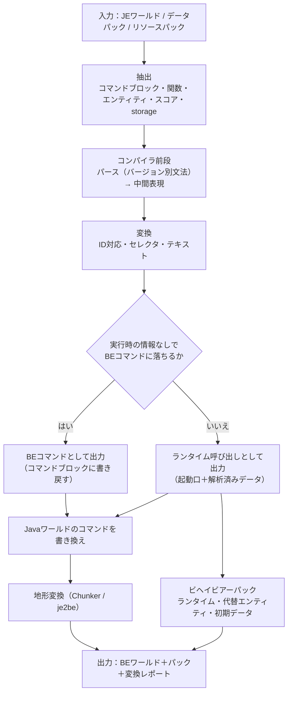

# JE→BE 配布ワールド変換コンバータ 設計方針

2026-11-15 時点。`design-notes.md`（2026-11-10の検討メモ）を、サンプルマップ19本の調査結果で見直したもの。食い違う箇所はこの文書を優先する。

「未確認」と書いた項目は、実機での検証（7章のPoC）が済むまで仮定として扱う。

## 1. 目的とスコープ

Java版（JE）の配布ワールドを、統合版（BE）で遊べる `.mcworld` に変換する。地形とブロックは既存の変換器（Chunker / je2be）に任せ、このプロジェクトはゲームロジック（コマンドブロック、データパック、Java専用エンティティ）の移植を担う。

| 項目 | 方針 |
| --- | --- |
| 利用者 | マップ作者による自作品の移植（2026-11-15確定）。半自動でよく、レポートと手直しのしやすさを重視する |
| 対象JEバージョン | 1.20.5〜26.x |
| 出力先BEバージョン | 最新版に追従する（2026-11-15確定）。Script APIはベータ版も使ってよい。互換性のためにベータ版が必要な場面を想定する。使うAPIのバージョンは `package.json` で固定し、BE更新時に上げる |
| 形態 | ローカルCLI |
| 開発の進め方 | AIエージェントがほぼ自律的に開発・検証できる構成にする |

## 2. 調査結果（設計の根拠）

対象はクラフターズコロニーの週間人気上位から集めた19本（`sample-map/`）。集計は `scripts/` のスクリプトで再現できる。Java専用機能の判定は正規表現による粗いものである。

### 2.1 マップの区分

| 区分 | 本数 | マップ |
| --- | --- | --- |
| データパックなし・単発コマブロのみ | 1 | 3000mアスレチック |
| データパックなし・チェーンあり | 3 | 深海からの脱出、帝國立海洋生態研究所、Aurora |
| データパックあり・単発コマブロのみ | 6 | 1000mwr、ONLY-UP、Rhythm-Parkour、この家には玄関がない、人狼クエスト、勇者と魔王 |
| データパックあり・チェーンあり | 5 | 27_island、Lock_in_pumpkin、back-to-back、エンドレス・コア、見習いの魔法使い |
| データパックだけ（コマブロなし） | 4 | distortion_hotel、古き信仰者の遺跡、競MOB、ClockmakerManor |

- データパックにロジックを持つマップは15本、コマンドブロックを持つマップも15本ある。どちらか一方だけの対応では大半のマップを扱えない。
- ClockmakerManorはワールドを含まず、データパック単体で配布されている。

### 2.2 コマンドブロック

- チェーンは合計1,975本。長さは1個が1,403本、2〜3個が429本、4〜10個が119本、11個以上が24本。
- 2個以上のチェーンが多いのは深海（310本、最長118個）とエンドレス・コア（173本）の2本。ほかは多くても数十本で、大半が短い。
- コマンド3,550個の粗い分類は、BEにも同名コマンドがあるもの2,033個、関数呼び出し573個、Java専用機能を含むもの935個、空9個。
- Java専用機能の内訳は、NBT付きの `summon`（564個）と表示用エンティティ（444個）が中心で、設置用の一度きりのコマンドが多い。
- 条件付きブロックは281個（5本のマップ、うちback-to-backが155個）。
- レッドストーンで動作を切り替えるリピートブロックが多い（27_islandに80個、深海に69個、エンドレス・コアに64個）。
- クリックイベント付きの `tellraw` が深海に87個ある。

### 2.3 データパック

- マクロを使うマップは、ワールド付きの14本中9本。
- 15本すべてが `marker` / `interaction` / 表示用エンティティ（`text_display`、`item_display`、`block_display`）のどれかを使う。`marker` だけのマップは1本で、残り14本は表示用か `interaction` を使う。
- `data` コマンドの対象は、多くのマップでstorageよりエンティティが多い。
- 規模の差が大きい（326行〜約7万行）。人狼クエストの約7万行のうち約6.1万行は、Animated Java（モデルアニメーション生成ツール）の出力である。競MOBも `item_display` への操作が2,400行ある。

### 2.4 バージョン

| バージョン | 本数 |
| --- | --- |
| 1.20.1 / 1.20.4 | 各1 |
| 1.20.6 | 1 |
| 1.21 | 2 |
| 1.21.4 | 2 |
| 1.21.11 | 2 |
| 26.2 | 2（ほかにデータパック単体1本が26.2〜26.3対応） |
| 26.3 | 7 |

- 1.20.5以降で19本中17本をカバーする。最多は26.x系である。
- 1.21.5でテキストの書き方がJSON形式からSNBT形式に変わった。対象範囲内に両方の書き方が存在する（JSON形式の時期が5本、SNBT形式の時期が12本）。
- 26.x系ではチャンクの保存形式が変わっている（パレットのキーが `id` / `properties`、保存先が `dimensions/minecraft/overworld/region`）。

## 3. 設計原則

1. **コンパイラとランタイムは1つ**。コマンドブロックもデータパックも同じパーサ、同じ中間表現、同じランタイムに通す。経路を分けるのは出力の段階だけにする。
2. **主経路はScript API側のランタイム**。BEコマンドへの書き換えは、それだけで完結する場合の出力形式と位置づける。
3. **中核はTypeScriptで書き、変換時（Node）とゲーム内で同じコードを使う**。マクロは実行時にコマンド文字列が決まるため、パーサと変換処理がゲーム内でも動く必要がある。
4. **Minecraftに依存しない部分を最大化する**。ランタイムの意味論はホストAPIから切り離し、Node上でテストできるようにする。
5. **Java側の正解は実サーバーの実行結果で決める**。ソースやWikiは理由を調べるときに使う。
6. **厳密に一致させる範囲を限定する**。スコア演算、storage、NBTパス、マクロ、関数の制御フローは一致させる。物理、モブの挙動、演出のタイミングは近似とし、レポートで警告する。
7. **変換できないものは黙って落とさず、レポートに出す**。
8. **LLMは決定的に書けない部分だけに使う**。変換時はクリックUIの再設計や未対応箇所の説明など。ゲーム実行時には呼ばない。

## 4. 全体構成

## 5. コンポーネント

### 5.1 抽出

- JEワールドから、コマンドブロック（種類、向き、条件付き、常時実行、コマンド本文）、看板、本、エンティティ、スコアボード、storage、forceload範囲を取り出す。
- データパックから、関数、タグ（`load` / `tick`）、進捗、`predicate`、ルートテーブルなどを読む。ZIP形式のパックと、ワールドなしのデータパック単体配布も扱う。
- 26.x系の保存形式に対応する。JE側の形式は変わり続けるため、最新版への追従を前提にする。
- `scripts/extract_command_blocks.py` が試作にあたる。

### 5.2 コンパイラ前段（パーサと中間表現）

- 対象は1.20.5〜26.xの文法。テキストはJSON形式とSNBT形式の両方を読む。バージョンは `DataVersion` と `pack_format` で判定する。
- 中間表現は、コマンドの構文木に実行コンテキスト（`execute` の as / at / positioned / rotated / anchored / in）の情報を付けたもの。
- ゲーム内でも動かすので、依存の重いライブラリは使わない。既存のパーサ（Spyglassなど）は文法の参照元として使う。

### 5.3 変換（中間表現 → BE向けの表現）

- ID対応（ブロックとブロックステート、アイテム、エンティティ、サウンド、パーティクル、エフェクト、エンチャント）。対応表は既存の資産（Geyserのmappingsなど）を参照する（ライセンス未確認）。
- セレクタ変換（`distance` → `r` / `rm`、`limit` / `sort` → `c` など）。`nbt=`、`predicate`、`advancements=` はランタイムで評価する。
- テキストコンポーネント → rawtext。クリックとホバーはBEにないため、UI再設計（5.9）へ回す。
- マクロ展開後のコマンドにも同じ変換をかけるため、対応表はパックに同梱する。

### 5.4 出力先の決定

**コマンド単位**

- 実行時の情報なしでBEコマンド1個に落ちる → BEコマンドとして出力する。
- それ以外 → ランタイム呼び出しとして出力する。

**チェーン単位**

| 条件 | 扱い |
| --- | --- |
| 全ブロックがBEコマンドに落ちる | そのまま残す。コマンド文字列だけを書き換える。成否の伝搬やコンパレーター出力は元のまま動く |
| 1個でも落ちない | 先頭ブロックを起動口に差し替え、チェーン全体をランタイムで実行する。2個目以降は無効化する |

- データパックの関数は、すべてランタイムで実行する。
- 常時実行のリピートチェーンをワールドから抜き出してtick処理に変える方式（仮想化）は、初期設計に含めない。レッドストーンで切り替えるリピートが多く、ブロックを残すほうが起動条件とチャンク読み込みをそのまま再現できるためである。性能が問題になったときの最適化として残す。

### 5.5 起動口

- コマンドブロックからランタイムを呼ぶ方法は、`/scriptevent` かカスタムコマンドのどちらかにする（PoCで決める）。
- カスタムコマンドのハンドラは読み取り専用の文脈で動き、ワールドへの書き込みは遅延実行が必要である（Microsoft公式ドキュメントで確認済み）。そのため、ランタイムに回したチェーンは「同tickの少し後」に動く前提で設計する。
- 読み取りだけの条件判定は、カスタムコマンドの成否として同期的に返せる見込みである（条件付きチェーンへの伝搬は未確認）。
- 静的に検出してレポートに出すもの：
  - ランタイムに回したチェーンの成否を、コンパレーターや後続の条件付きブロックが読んでいる箇所。
  - 同tick内で、ランタイムに回したチェーンとBEコマンドのまま残したチェーンが同じ状態を読み書きする箇所。
  - コマンドブロック自身を書き換えるコマンド（`data modify block` など）。

### 5.6 ランタイム

- 解析済みの構文木を解釈実行する方式から始める。JSコードへのコンパイルは、性能が問題になった箇所にだけ後から入れる。
- 2層に分ける。
  - **中核（Minecraft非依存）**：実行コンテキスト、関数呼び出しと `return`、スコア演算、storage、NBTパス、マクロ展開、`schedule`、`execute store`、条件評価。
  - **ホスト層**：Script APIへの薄い接続。エンティティ検索、ブロック操作、BEコマンドの実行（`runCommand`）、永続化。
- BEに同等のコマンドがあるものは、ホスト層からBEコマンドとして実行する。
- `tick` タグの関数はScriptのタイマーから毎tick呼ぶ。`load` はワールド読み込み時に呼ぶ。
- 状態（storage、スケジュール、仮想NBT）は動的プロパティに保存する（サイズ制限は未確認）。
- 後の段階で足すもの：`team`、`bossbar`、`trigger`、進捗、`predicate`、ルートテーブル、`item`、`attribute`、`damage`。

### 5.7 仮想NBT層

`data get entity`、`nbt=` セレクタ、NBT付きの `summon`、`execute store ... entity` は、すべてエンティティやブロックのNBTを読み書きする。次の2つを合成して、JavaのNBTとして見せる層を独立した部品として作る。

- **Script APIから取れる値**：位置、向き、タグ、体力、所持品、名前など。
- **ランタイムが保持する値**：代替エンティティの表示設定、BEに対応する項目がないNBT。

対応するNBTパスは、コーパスでの使用頻度順に決める（頻度の集計は未実施）。

### 5.8 代替エンティティ

15本すべてが使うため、最優先の部品とする。パックに同梱し、ワールド内の既存エンティティは初期化時に置き換える。

| 種類 | 難度 | 代替 |
| --- | --- | --- |
| `marker` | 低 | 不可視のカスタムエンティティ |
| `interaction` | 中 | 当たり判定だけのエンティティ＋クリックイベント |
| `text_display` | 中〜高 | カスタムエンティティでの文字表示。背景、向き、拡大縮小の再現度が課題 |
| `item_display` / `block_display` | 高 | モデルを持つカスタムエンティティ。リソースパックのモデル変換が必要 |

Animated Javaなどの機械生成アニメーションは、1行ずつ解釈実行すると性能も再現度も見込めない。生成物のパターンを認識し、BEのエンティティアニメーションへ直接変換する専用経路を別に設ける。初期は未対応としてレポートに出す。

### 5.9 クリックUIとイベント検知

- `tellraw` や本のクリックイベント、看板のクリック、`trigger` は、BEのフォーム（`@minecraft/server-ui`）やブロック操作イベントに置き換える。変換時にLLMで再設計する候補である。
- スコアボードの統計値や進捗によるイベント検知は、Script APIのイベントへの対応表で置き換える（アイテム使用、死亡、退出など）。

### 5.10 ワールドへの書き戻し

- 第一候補：**変換前のJavaワールドでコマンド文字列を書き換え、その後で地形変換器に通す**。Java側の形式はすでに読み書きできるため、BEのLevelDBを直接編集しなくて済む。変換器がコマンド文字列をそのまま運ぶかは未確認。
- 代替案：`.mcstructure` を生成し、初回起動時にスクリプトで読み込む。
- スコアとstorageの初期値、代替エンティティの配置は、JSONとしてパックに同梱し、初回起動時に初期化する。

### 5.11 変換レポート

- 元の座標・関数と、生成物の対応表。
- チェーンごとの扱い（そのまま残す／ランタイム実行）とその理由。
- 未対応の機能、順序ずれの恐れがある箇所、見た目が変わる箇所。
- 作者が読む前提で、Java側の用語で書く。
- 作者の手修正を再変換後も保てるよう、元の関数パスや座標に紐づく上書きの仕組みを設ける（詳細は未設計）。

## 6. 検証

| 層 | 確認すること | 手段 |
| --- | --- | --- |
| 1. Nodeのみ | パーサ、変換、ランタイム中核 | Javaサーバーで記録した正解データとの突き合わせ |
| 2. ヘッドレスサーバー | BEコマンドの実挙動、tick内の順序、ホスト層 | BDSとJavaサーバーを同じCLIで操作するブリッジ |
| 3. 擬似プレイヤー | クリックやアイテム使用で起動するギミック | BEは `SimulatedPlayer`、JEはボット |
| 4. 実クライアント | 見た目、代替エンティティ、UI | サーバー側で視点を固定し、JEとBEのスクリーンショットを比較 |

- ブリッジは、コマンド実行、状態ダンプ（スコア、タグ、ブロック、エンティティ）、ログ取得、リロードを提供する。BDS側は `@minecraft/server-net` を使うテスト用パックで実現する。
- 正解データは「初期状態、実行するコマンド、結果の状態」の組として保存し、日常の開発はNodeだけで回す。
- 通しプレイは人が行う。作者のJava版プレイ記録を回帰テストに使う案がある。
- 指標は「人手なしで動くギミックの割合」と「実際に壊れた箇所のうち、レポートが事前に警告していた割合」。

## 7. 進め方

| 段階 | 内容 | 到達点 |
| --- | --- | --- |
| M0 | 検証基盤（ブリッジ）とPoC | 下のチェックリストが埋まる |
| M1 | パーサ、ID対応、セレクタ・テキスト変換、BEコマンド出力、書き戻し | データパックなしの4本が対象になり、変換の流れ全体が通る |
| M2 | ランタイム中核と起動口 | 関数、スコア、storage、マクロ、`schedule` が動く |
| M3 | 仮想NBT層と代替エンティティ（`marker`、`interaction` から） | データパックのあるマップが動き始める |
| M4 | 表示用エンティティ、クリックUI、進捗、`predicate`、ルートテーブル、アイテムのデータ | 対応マップの拡大 |
| M5 | 機械生成アニメーションの専用経路、性能最適化 | 大規模マップへの対応 |

### PoCチェックリスト（M0）

- [ ] 地形変換器（Chunker / je2be）は、コマンドブロックのコマンド文字列、向き、条件付き、常時実行をそのまま運ぶか
- [ ] 同じく、エンティティとスコアボードはどこまで残るか
- [x] `/scriptevent` とカスタムコマンドは、コマンドブロックから呼べるか。呼んだ処理は同tick内のどの時点で動くか
  - どちらも呼べる（`CommandPermissionLevel.GameDirectors`）。カスタムコマンドのハンドラはチェーンの途中で同期的に動く。`scriptevent` のハンドラと `system.run` で遅らせた処理は、チェーンの最後まで進んだ後、同じtick内で動く
- [x] カスタムコマンドの失敗で条件付きチェーンが止まるか。コンパレーター出力はどうなるか
  - `Failure` で止まり、コンパレーターも出力しない。BEコマンドの成否と同じ扱いになる。戻り値なし（`undefined`）と `scriptevent` は成功扱い
- [x] カスタムコマンドのハンドラ内で禁止される操作の実リスト（スコア書き込み、動的プロパティ、タグ付与など）
  - 禁止：スコア書き込み、`runCommand`、ブロック設置、エンティティ召喚。可能：ブロックとエンティティの読み取り、動的プロパティの読み書き。遅延実行と `scriptevent` のハンドラでは、どれも可能
- [x] 遅延実行した処理の中で、`runCommand` は同期的に成否を返すか。直後の読み取りに結果が反映されるか
  - 同期的に `successCount` が返り、直後の読み取りに反映される。ただし実行時の失敗は例外にならず `successCount: 0` になり、理由の文字列は取れない
- [x] 起動口から実行コンテキスト（実行元のブロック位置、ディメンション）を復元できるか
  - `execute` を挟まなければ `sourceBlock` で取れる。挟むと発生元が `Server` になり失われる。カスタムコマンドの引数で `~ ~ ~`（位置）、`^ ^ ^1`（向き）、`@s`（実行者）を渡せば復元できる
  - 未解決：`execute in the_nether` を挟むとハンドラが呼ばれない
  - BEでは整数座標のx・zが中心に寄る（`positioned 7 8 9` → 7.5, 8, 9.5。JEでは 7.0, 8.0, 9.0）。変換時の補正が必要
  - 根拠：`poc/launcher/launcher.servers.test.ts`、`poc/launcher/results.json`（BDS 1.26.63.1、2026-11-15）
- [ ] `tick.json`、スクリプト、コマンドブロックのtick内の実行順
- [ ] 動的プロパティのサイズ制限と、ワールド再起動後の状態復元
- [ ] 常時実行のリピートが100個前後あるマップで、毎tickの起動が性能上耐えるか

## 8. 未決事項とリスク

**未決事項**

- 地形変換器の選定（ライセンス、落とすデータの比較）。
- ID対応表の入手元とライセンス。
- 手修正を再変換後も保つ仕組みの詳細。
- リソースパックの変換範囲（カスタムモデル、フォント、シェーダー）。

**リスク**

| リスク | 内容 | 対応 |
| --- | --- | --- |
| 同tick内の順序ずれ | ランタイムに回したチェーンは遅れて動く。BEコマンドのまま残したチェーンと依存があると結果が変わる | 静的に検出して警告。影響の大きさは混在型のマップで実測する |
| ベータAPIの変更 | ベータ版はBE更新のたびに破壊的変更があり得る。出力ワールドで「ベータAPI」実験機能の有効化が必要 | ベータAPIの利用をホスト層に閉じ込め、更新時はBDSでの回帰テストで検出する |
| 性能 | 全処理がJS経由になる。スマホでの毎tick処理、機械生成アニメーション | 実測後に、JSへのコンパイルや専用経路で対処する |
| 見た目の再現度 | 表示用エンティティ、カスタムモデル、フォントによるGUI | 早い段階でスクリーンショット比較を用意する |
| JE側の形式変更 | 保存形式と文法が継続的に変わる | 抽出とパーサをバージョン別にテストする |
| 権利 | 配布マップの多くは改変・再配布を禁止している | 作者本人の利用を前提にする |
| コーパスの偏り | 人気上位19本であり、規模の大きい作品に寄っている可能性がある | 作者へのヒアリングと、コーパスの追加で補う |

## 9. 次に行う調査

- `data` コマンドと `nbt=` セレクタで使われるNBTパスの頻度（仮想NBT層の対応範囲を決める）。
- 関数単位で見た、BEコマンドだけで完結する割合。
- コマンドブロックに隣接するコンパレーターの数と、コマンドブロック自身を書き換えるコマンドの数。
- リソースパックの機能（カスタムモデル、フォント、シェーダー）の使用状況。
- 進捗、`predicate`、ルートテーブルの使われ方。
